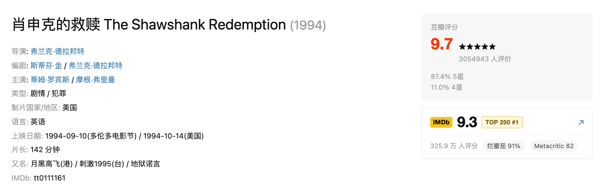
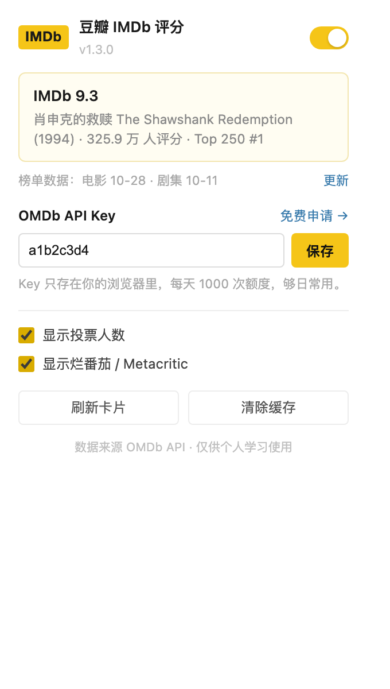
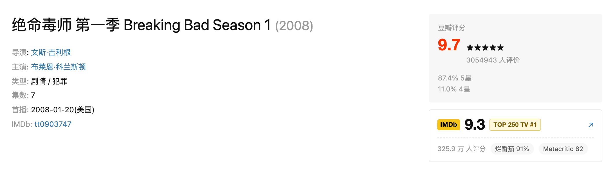

# 豆瓣 IMDb 评分

[](https://github.com/manongchopin/imdb-on-douban/actions/workflows/test.yml)
[](LICENSE)

在豆瓣电影页面右侧，紧挨着「豆瓣评分」显示这部电影的 **IMDb 评分**、投票数，以及它有没有进 **IMDb Top 250**——电影榜显示 `TOP 250 #1`，剧集榜显示 `TOP 250 TV #1`。



---

## 一、先说结论：为什么不是「直接爬 IMDb 页面」

你最初的设想是「抓豆瓣页面 → 打开 IMDb 对应页面 → 抓 IMDb 评分 → 显示」。这个思路完全正确，**前两步也确实是这么实现的**，但第三步在 2025 年之后变得不可靠：

| 方案 | 实际结果 |
| --- | --- |
| 直接 `fetch("https://www.imdb.com/title/tt0111161/")` | 返回 **202 + AWS WAF 的 JS 挑战页**，拿不到 HTML，除非浏览器里已经留下 WAF 的 Cookie |
| 直接调 IMDb 网站自己用的 GraphQL | 服务端校验 `Origin` / `Referer` 必须是 `imdb.com`，扩展发起的请求会被 **403** |
| 走 **OMDb API**（IMDb 数据的官方镜像） | ✅ 稳定、CORS 友好、免费额度 1000 次/天 |

所以这个插件是**双通道**设计：

1. **主通道：OMDb API**（需要一个免费 Key，申请 1 分钟，每天 1000 次）；
2. **备用通道：直连 IMDb**（不用 Key，抓标题页 JSON-LD + 并发试一次 GraphQL，失败就引导去配 Key）。

备用通道保留了你原本设想的「抓页面」完整实现（`src/lib/imdb-direct.js`），在部分网络环境或浏览器已有 IMDb Cookie 时确实能直接出分。它失败时会在卡片里出现一个「粘贴 Key」的表单，粘完立刻出分，不用跳来跳去。

---

## 二、安装

1. 打开 Chrome，地址栏输入 `chrome://extensions/`
2. 右上角打开「开发者模式」
3. 点「加载已解压的扩展程序」，选择本文件夹（含 `manifest.json` 的那一层）
4. 工具栏出现黄色 IMDb 图标即安装成功

> 只支持 Chrome / Edge 等 Chromium 内核浏览器（Manifest V3）。

## 三、使用

1. 随便打开一部电影，例如 <https://movie.douban.com/subject/1292052/>
2. 第一次会看到「显示 IMDb 评分」的引导卡片：
   - 点「打开申请页」→ 选 **FREE** → 填邮箱
   - 点邮件里的激活链接，拿到 8 位 Key
   - 把 Key 粘到卡片里 → 保存（会先验证再保存）
3. 之后所有豆瓣电影页都会直接显示评分，**包括你之后卸载重装只要 Key 还在**（存在 `chrome.storage.sync`，跟着 Google 账号同步）



点工具栏图标可以随时改 Key、开关「显示投票人数 / 显示烂番茄」「刷新卡片」「清除缓存」。

---

## 四、工作原理

```
┌─────────────────────────── 豆瓣页面 (movie.douban.com/subject/1292052/) ─┐
│                                                                          │
│  content script (src/content/content.js)                                 │
│    1. 从 DOM 读：片名、原名、又名、年份、类型、页面里的 tt id              │
│    2. 画一个卡片骨架（先让用户看到东西在加载）                             │
│    3. chrome.runtime.sendMessage({type:'LOOKUP', payload})  ───┐         │
└───────────────────────────────────────────────────────────────┼─────────┘
                                                                │
┌──────────────────────── Service Worker (src/background.js) ───▼─────────┐
│  4. 查缓存 chrome.storage.local（评分 7 天 / 片名→tt 映射 30 天）        │
│  5. 没有 tt id 时：用片名 + 年份去 OMDb 搜索，按相似度挑最像的一条        │
│  6. 有 tt id 时：GET https://www.omdbapi.com/?i=tt0111161                │
│  7. 归一化成 {rating, votes, extras, url} 并回传、写缓存                  │
└─────────────────────────────────────────────────────────────────────────┘
                                                                │
┌───────────────────────────────────────────────────────────────▼─────────┐
│  content script 收到结果 → 渲染评分 / 投票数 / 烂番茄 → 结束             │
└─────────────────────────────────────────────────────────────────────────┘
```

**为什么网络请求放在 Service Worker 而不是 content script？**

- content script 的 `fetch` 受**页面**的 CORS 限制，豆瓣页面不能去请求 imdb.com；
- 扩展在 `host_permissions` 里声明过的域名，Service Worker 的请求**不受 CORS 限制**（跨域读响应体没问题）；
- 缓存、并发去重、限流这些逻辑集中在一处，content script 只负责画界面。

**并发去重**：`background.js` 里有一张 `inflight` Map，同一部片同时只发一次请求（豆瓣页面有时会触发多次重渲染），后来者直接等前一个 Promise。

---

## 五、IMDb Top 250 名次（电影 + 剧集）

头一行会多一个名次徽章，点它跳对应的 IMDb 榜单页，没进榜的不显示：

| 页面类型 | 榜单 | 徽章 |
| --- | --- | --- |
| 电影 | [Top 250 movies](https://www.imdb.com/chart/top/) | `TOP 250 #1` |
| 剧集 | [Top 250 TV shows](https://www.imdb.com/chart/toptv/) | `TOP 250 TV #1` |



查名次时先按页面类型找对应的榜，没找到再兜底查另一个（豆瓣偶尔把剧集标成电影），所以不会因为类型判断错了就漏掉徽章。

名次有三条来源，优先级从高到低：

| 来源 | 什么时候用 |
| --- | --- |
| 每天自动刷新 | 后台用 `chrome.alarms` 每天唤醒一次（最快 20 小时一次），先试 IMDb 榜单页，失败退回 Internet Archive 快照，成功就覆盖内置数据 |
| 弹窗里的「更新」按钮 | 想立刻刷新的时候，逻辑同上 |
| `data/top250.js`、`data/top250-tv.js` 内置快照 | 兜底。打开页面立刻有名次，不联网，也不看网络脸色 |

自动刷新失败不会打扰你，只是继续用旧数据；名次没变化时也不会改动日期，避免每天刷新一次"假更新"。

**仓库里那份快照**由 GitHub Actions 每周一自动重建（`.github/workflows/top250.yml`），
所以新装插件的人拿到的也是新鲜数据。快照里每条只有 4 个字段（名次、tt id、片名、年份），250 条约 20 KB。

想手动重建：

```bash
node tools/update-top250.mjs           # 两个榜都更新（直连 IMDb，被拦自动退回网络存档）
node tools/update-top250.mjs --movie   # 只更新电影榜
node tools/update-top250.mjs --tv      # 只更新剧集榜
node tools/update-top250.mjs --wayback # 只用网络存档
```

弹窗里会显示当前用的是哪天的数据（`Top 250 数据：2026-10-28`）。

## 六、片名怎么对上 IMDb 的

豆瓣的 `#info` 里通常直接写着 `IMDb: tt0111161`，这是**最可靠**的来源，有就直接用，零搜索、零误差。

没有的时候才需要「搜索 + 挑一个」（`src/lib/match.js`）：

1. 候选片名按优先级排：`原名（英文/日文等） → 中文名 → 又名 1..n`，并给剧集补一个去掉「第二季 / Season 2」后缀的版本；
2. 逐个拿去 `?s=<片名>&y=<年份>&type=movie|series` 搜索（最多 4 次，省额度）；
3. 对每条结果打分：**片名相似度 × 70 + 年份 × 20 + 类型 × 10**
   - 片名相似度用字符二元组的 Dice 系数，中英文都能算（"肖申克的救赎" vs "肖申克的救赎 4K" 也能拿高分）；
   - 年份差 0 年满分，±1 年 0.6，差 3 年以上直接判定「不自信」；
   - `episode` 类型大幅降权，避免匹配到「某某电影幕后特辑」；
4. 总分 ≥ 55 且片名 ≥ 0.62 **且年份差 ≤ 2** 才认为匹配成功。

匹配成功后会把 `豆瓣 subject id → tt id` 缓存 30 天，所以同一部片永远只搜一次。

---

## 七、目录结构

```
imdb-on-douban/
├── .github/workflows/         # test.yml（每次 push 跑测试）+ top250.yml（每周重建榜单）
├── manifest.json              # MV3 清单
├── data/
│   ├── top250.js              # 电影 Top 250 内置快照（脚本生成，勿手改）
│   └── top250-tv.js           # 剧集 Top 250 内置快照（脚本生成，勿手改）
├── src/
│   ├── background.js          # Service Worker：消息路由 + 请求 + 缓存 + 徽标
│   ├── lib/
│   │   ├── omdb.js            # OMDb 请求构造 / 响应解析 / 错误码归一化
│   │   ├── imdb-direct.js     # 直连 IMDb：JSON-LD、__NEXT_DATA__、GraphQL
│   │   ├── match.js           # 片名相似度与候选打分（纯函数）
│   │   ├── top250.js          # 榜单解析、索引、校验（纯函数）
│   │   ├── format.js          # 评分/票数/片名格式化（纯函数）
│   │   ├── cache.js           # chrome.storage.local + TTL
│   │   └── settings.js        # chrome.storage.sync 配置
│   ├── content/
│   │   ├── content.js         # 读豆瓣 DOM、渲染卡片、内联配置 Key
│   │   └── content.css        # 卡片样式（贴近豆瓣原生风格）
│   └── popup/                 # 工具栏弹窗
├── icons/                     # 4 个尺寸的图标（由 tools/make-icons.mjs 生成）
├── tools/                     # 图标生成、榜单更新、本地预览截图（开发用，不参与运行）
└── tests/                     # node:test 单元测试 + 无网络集成测试
```

没有构建步骤：`manifest.json` 直接指向源文件，改完在 `chrome://extensions` 点一下刷新就能看到效果。

---

## 八、开发与测试

```bash
npm test          # 48 个用例：片名匹配、OMDb 解析、直连解析、缓存链路、manifest 完整性
npm run icons     # 用本机 Chrome + sips 重新生成 4 个尺寸图标
```

**无网络集成测试**：`tests/lookup.test.mjs` 用假的 `chrome.*` 和假的 `fetch` 跑通
「片名 → 搜索 → 挑片 → 取分 → 挂上 Top 250 名次（电影/剧集两个榜）→ 写缓存 → 二次命中缓存」的完整链路，以及直连失败后的
「冷静期」（1 小时内不再重复尝试，避免每开一部片都白等几秒）。

**视觉预览**（不依赖豆瓣在线）：

```bash
node tools/preview/shoot.mjs \
  --url "file://$PWD/tools/preview/card.html?state=ok" \
  --stub tools/preview/stub.js --out /tmp/card.png --size 1060x420
```

`?state=ok|need_key|no_match|error` 可以切换卡片状态，`&variant=tv` 换成剧集页面的 DOM。
新版 headless Chrome 已经不加载扩展了，所以这里用 CDP 在页面脚本执行前注入一个假的
`chrome` 对象，再对**真实页面文件**截图。

---

## 九、已知限制

- **必须配一次 OMDb Key**：不配的话只能靠实验性的直连通道，成功率取决于你的网络和浏览器里有没有 IMDb 的 Cookie；
- **OMDb 免费额度 1000 次/天**：靠缓存 + 去重扛住；如果超了，卡片会提示「额度用完」，第二天自动恢复；
- **豆瓣改版**：选择器集中在 `content.js` 的 `readPage()` 里，改版了只需要改这一处；
- **同一部片有多版**（如 1984 / 2021 两版《沙丘》）：靠年份 + 类型区分，年份差 3 年以上不会强行匹配；
- **两个 Top 250 名次都可能滞后几天**：默认用内置快照，点弹窗「更新」可拉最新；榜单尾部名次变化最频繁
- **只在 `movie.douban.com/subject/<id>/` 这类主页生效**，`/photos`、`/comments` 等子页面会跳过。

## 十、隐私

- 只把**片名 / 年份 / IMDb id** 发给 `omdbapi.com`（直连模式下额外请求 `imdb.com`）；
- 点「更新榜单」时才会访问 `imdb.com` 或 `web.archive.org`，平时不联网拉榜单；
- Key 存在 `chrome.storage.sync`（会同步到你的 Google 账号），插件不上传到任何第三方；
- 无统计、无埋点、无远程脚本。

## 十一、数据来源声明

IMDb 数据经 OMDb API 获取，仅供个人学习使用；商业用途请参考
[IMDb 数据使用条款](https://help.imdb.com/article/imdb/general-information/can-i-use-imdb-data-in-my-software/G5JTRESSHJBBHTGX)。

## 十二、关于

这是一个个人学习项目，由 **chopinfisher** 与 AI 编程助手协作完成：需求、交互、代码和测试都是边聊边做出来的。

它也是一个很好的「浏览器扩展入门样本」：没有构建系统、没有第三方依赖，`manifest.json` 就是全部配置，
读一遍 `src/background.js` 和 `src/content/content.js` 就能明白 MV3 的消息传递与跨域请求模型。

如果它对你有用，欢迎 fork 一份自己改。豆瓣改版时，通常只需要调整
`src/content/content.js` 里的 `readPage()`。
